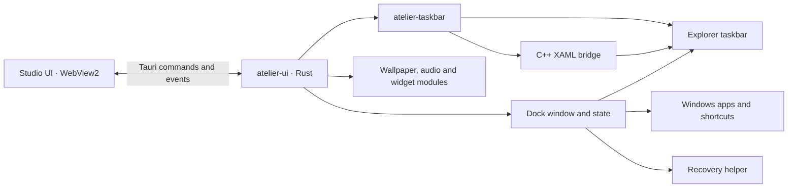

# Atelier

[](https://www.rust-lang.org/)
[](https://v2.tauri.app/)
[](docs/COMPATIBILITY.md)
[](docs/crates/TASKBAR.md)
[](docs/crates/UI.md)
[](docs/crates/TASKBAR.md)
[](docs/crates/WALLPAPER.md)
[](docs/crates/AUDIO.md)
[](#license)

[](#features)
[](#features)
[](docs/crates/UI.md)
[](docs/FAILURES_AND_RECOVERY.md)
[](#features)

Atelier is a Windows desktop customization project built with Rust and Tauri v2. Its Studio can customize the Explorer taskbar and provide an optional, separate macOS-style dock. Wallpaper, audio and widget subsystems exist in the workspace, but their Studio controls are still in development.

## Features

- **Windows Taskbar:** configure materials, floating geometry and presets. On supported Windows 11 XAML taskbars, adjust app button and icon appearance.
- **macOS Taskbar:** a separate dock for pinned shortcuts and running windows, with display and edge selection, sizing, layouts, indicators and auto-hide. Enabling it hides the native Windows taskbar, including the notification area.
- **Recovery:** the dock uses a helper process before hiding Explorer windows; native taskbar positioning has a separate guardian. See [Failure Modes & Recovery](docs/FAILURES_AND_RECOVERY.md).
- **Planned Studio controls:** wallpaper playback, audio visualization and widgets. Their presence in the workspace does not mean their complete user-facing flows are implemented.

## Architecture



The Tauri application is the primary Studio entry point. The separate `atelier-core` binary has its own tray and initialization path and is not the Tauri IPC backend. Details: [Architecture](docs/ARCHITECTURE.md).

## Documentation

### Guides and architecture

- [Architecture and data flow](docs/ARCHITECTURE.md)
- [Repository structure](docs/STRUCTURE.md)
- [Configuration and storage](docs/CONFIGURATION.md)
- [Compatibility](docs/COMPATIBILITY.md)
- [Failure modes and recovery](docs/FAILURES_AND_RECOVERY.md)
- [Development and testing](docs/DEVELOPMENT.md)
- [Security considerations](docs/SECURITY.md)
- [Contributing](CONTRIBUTING.md) · [Changelog](CHANGELOG.md)

### Crate references

The names below match the directories in `crates/`. Cargo package names retain the `atelier-` prefix.

- [`common`](docs/crates/COMMON.md) — configuration, presets and errors.
- [`core`](docs/crates/CORE.md) — experimental daemon and tray.
- [`taskbar`](docs/crates/TASKBAR.md) — Explorer styling, positioning and recovery.
- [`ui`](docs/crates/UI.md) — Studio and the separate dock.
- [`wallpaper`](docs/crates/WALLPAPER.md) — wallpaper infrastructure.
- [`audio`](docs/crates/AUDIO.md) — audio capture and spectrum analysis.
- [`widget`](docs/crates/WIDGET.md) — widget infrastructure.

## Build and run

Prerequisites: Windows 10/11, a stable Rust MSVC toolchain, Visual C++ Build Tools with a Windows SDK, and WebView2 Runtime. The XAML bridge is compiled from C++ during the Cargo build. See [Compatibility](docs/COMPATIBILITY.md) for Windows-specific limitations.

```powershell
cargo check --workspace
cargo run -p atelier-ui --bin Atelier
```

For a development copy that does not lock `target\debug\Atelier.exe`, run `scripts\run-dev.cmd`. It stops matching Atelier development processes before rebuilding; see [Development](docs/DEVELOPMENT.md).

## Tests

```powershell
cargo test -p atelier-common
cargo test -p atelier-ui --lib
cargo check --workspace
```

The repository also contains an isolated dock smoke test and Playwright UI tests. Some taskbar integration tests interact with the real Explorer taskbar; read [Development and testing](docs/DEVELOPMENT.md) before running them.

## License

The workspace declares `MIT OR Apache-2.0` in `Cargo.toml`. License text files are not currently included in the repository.
