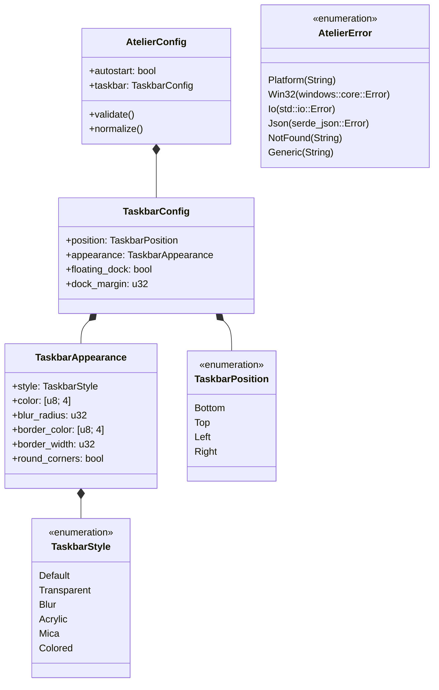

# atelier-common

`atelier-common` defines the foundational data types, serialization models, named style presets, and unified error handling types shared across the entire **Atelier** workspace.



---

## Architectural Highlights

### 1. Unified Configuration Schema (`config.rs`)
- Implements `Serialize` and `Deserialize` using Serde with backward-compatibility fallbacks.
- Provides default configurations matching stock Windows appearance.
- Includes automatic normalization methods that validate colors, ensure valid alpha channels, clamp margins to physical monitor boundaries, and sanitize user input.

---

### 2. Built-in Appearance Presets (`presets.rs`)
Provides pre-tuned appearance profiles that can be applied with a single click or keyboard shortcut:

| Preset Name | Style | Visual Description |
| :--- | :--- | :--- |
| **Default** | `Default` | Standard native Windows 10/11 taskbar appearance. |
| **MacOsDock** | `Acrylic` | Centered floating dock with rounded corners and translucent frosted glass backdrop. |
| **Windows11Clear**| `Transparent`| Completely transparent background with crisp app icons and system tray elements. |
| **CyberpunkNeon** | `Colored` | Deep purple translucent background with hot-pink border accents. |
| **MinimalDark** | `Blur` | Subtle dark blur backdrop with zero borders for distraction-free workflows. |
| **FrostedGlass** | `Mica` | Soft Windows 11 Mica composition that adapts smoothly to dark and light desktop wallpapers. |

---

### 3. Unified Error Architecture (`error.rs`)
- Uses `thiserror` to provide ergonomic, strongly-typed error variants for Win32 API failures, I/O errors, JSON parse issues, and platform incompatibilities.
- Standardizes error conversion across all workspace crates using a common `Result<T, AtelierError>` type alias.

---

## Testing

```powershell
# Run unit tests for atelier-common (3 tests)
cargo test -p atelier-common
```
Unit tests ensure that legacy configuration files automatically deserialize with safe modern defaults, button widths are correctly normalized, and Windows native appearance is preserved upon reset.
