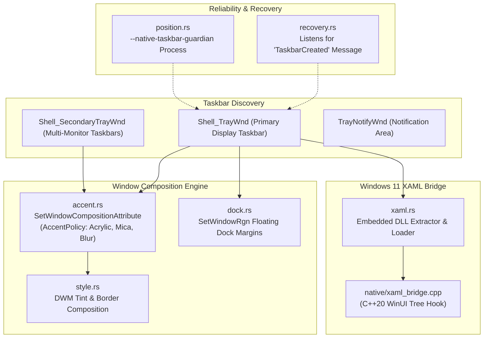
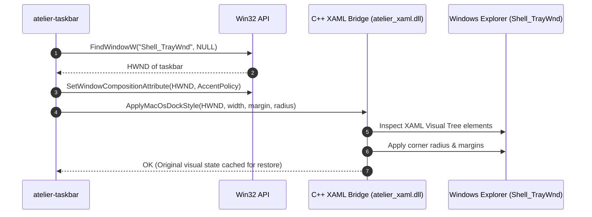

# atelier-taskbar

`atelier-taskbar` is the native taskbar manipulation and styling engine for **Atelier**. It provides window discovery, DWM composition accent styling (Acrylic, Mica, Transparent), floating dock window region clipping, Explorer crash recovery, and a C++20 XAML visual tree injection bridge for Windows 11.



---

## Architectural Highlights

### 1. Dual-Path Taskbar Styling (DWM + XAML Bridge)
Windows 10 and Windows 11 handle taskbars differently:
- **Windows 10 & Win11 (DWM Accent Policy)**: Invokes the undocumented `SetWindowCompositionAttribute` API to inject `ACCENT_ENABLE_BLURBEHIND`, `ACCENT_ENABLE_ACRYLICBLURBEHIND`, or `ACCENT_ENABLE_TRANSPARENTGRADIENT`.
- **Windows 11 Modern Taskbar (XAML Visual Tree)**: The Windows 11 taskbar is hosted inside `Taskbar.ExperienceHost` and uses WinUI/XAML. Standard Win32 calls cannot alter internal XAML button layouts. Atelier uses an embedded C++20 bridge (`atelier_xaml.dll`) to safely traverse the modern visual tree and apply spacing, margin, and backdrop adjustments.



---

### 2. Floating Dock Region Clipping
To transform the full-width rectangular Windows taskbar into an elegant centered floating dock:
- `dock.rs` calculates content boundaries based on active app icons and pinned shortcuts.
- Generates a rounded rectangular region using `CreateRoundRectRgn`.
- Applies the clipping region to `Shell_TrayWnd` via `SetWindowRgn(hwnd, rgn, TRUE)`.
- Updates dynamically as applications launch or close, keeping the dock centered.

---

### 3. Explorer Crash Recovery & Guardian Processes
If Windows Explorer crashes or restarts:
- All custom regions and DWM composition attributes are wiped out by the shell restart.
- `recovery.rs` registers for the broadcast message `RegisterWindowMessageW("TaskbarCreated")`.
- Upon receipt of `TaskbarCreated`, the crate automatically rediscovers the new taskbar handles and reapplies all active styles.
- An isolated guardian process (`--native-taskbar-guardian`) monitors the parent application and guarantees the taskbar is restored to stock Windows appearance if Atelier exits unexpectedly.

---

## Crate Modules

| Module | Source File | Description |
| :--- | :--- | :--- |
| **Discovery** | [`src/discovery.rs`](src/discovery.rs) | Locates primary and secondary taskbars, tray notification areas, and start buttons. |
| **Accent Composition** | [`src/accent.rs`](src/accent.rs) | Wraps `SetWindowCompositionAttribute` and `ACCENT_POLICY` definitions. |
| **Style Manager** | [`src/style.rs`](src/style.rs) | High-level styling presets (Acrylic, Mica, Blur, Clear, Colored). |
| **Dock Region** | [`src/dock.rs`](src/dock.rs) | Centered floating dock shape generation using Win32 GDI regions. |
| **Position & Guardian** | [`src/position.rs`](src/position.rs) | Screen edge positioning, workarea preservation, and background guardian monitoring. |
| **Recovery** | [`src/recovery.rs`](src/recovery.rs) | Event loop listening for `TaskbarCreated` shell recreation events. |
| **XAML Loader** | [`src/xaml.rs`](src/xaml.rs) | Runtime extractor and loader for the embedded C++20 XAML bridge DLL. |
| **Native Bridge** | [`native/xaml_bridge.cpp`](native/xaml_bridge.cpp) | Modern Windows 11 WinUI visual tree traversal and element manipulation. |

---

## Testing

```powershell
# Run taskbar tests (note: live desktop tests are ignored by default for safety)
cargo test -p atelier-taskbar
```
