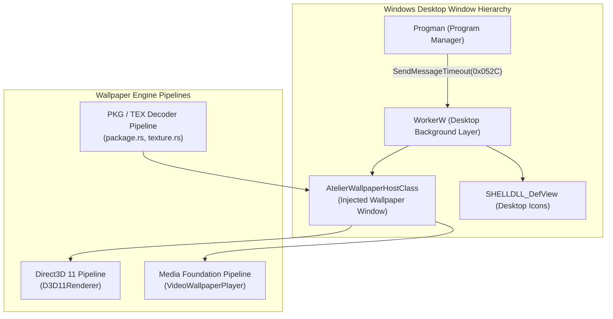
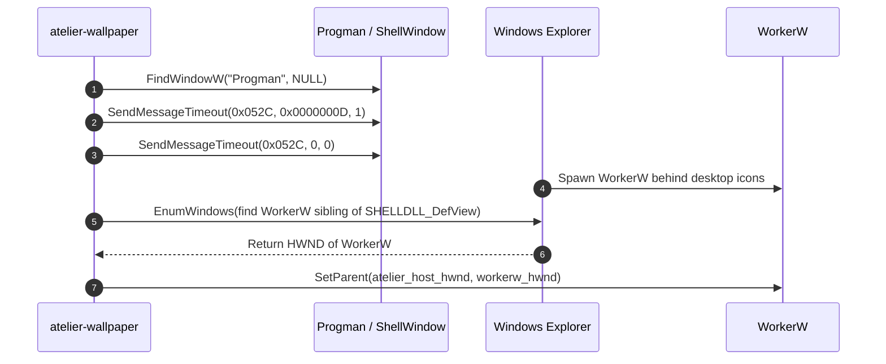
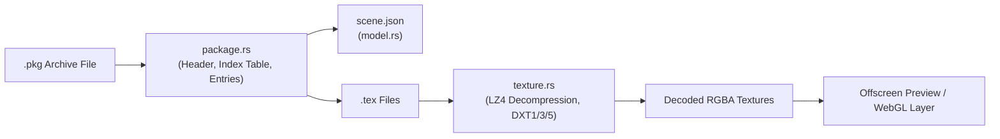
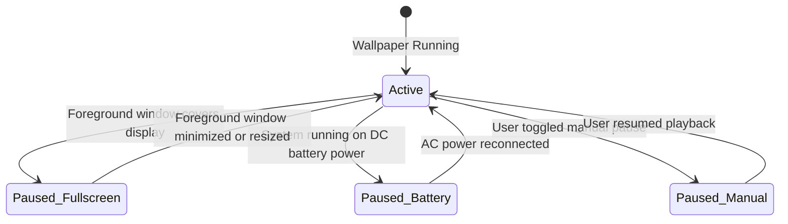

# atelier-wallpaper

`atelier-wallpaper` provides the low-level Windows desktop wallpaper engine for **Atelier**. It manages desktop window hierarchy injection via `WorkerW`, Direct3D 11 rendering, Media Foundation hardware-accelerated video decoding, display occlusion monitoring, and decompression of Wallpaper Engine `.pkg` archives and `.tex` textures.



---

## Architectural Highlights

### 1. WorkerW Desktop Host Window Acquisition
In Windows, desktop icons are hosted inside `SHELLDLL_DefView`. To display a live wallpaper beneath desktop icons without covering them, Atelier sends an undocumented message (`0x052C`) to `Progman`. This causes the Windows Explorer shell to spawn a `WorkerW` window sibling between `Progman` and the icons:



If Windows 11 disables redirection bitmaps (`WS_EX_NOREDIRECTIONBITMAP`), the engine directly binds to `Progman` as fallback.

---

### 2. Wallpaper Engine Package and Texture Pipeline



- **`package.rs`**: Parses binary package archives (`PKGV0001`, `PKGV0002`). Reads entry metadata without loading the entire archive into RAM, and extracts individual assets on demand.
- **`texture.rs`**: Decodes proprietary Wallpaper Engine `.tex` formats, supporting LZ4 decompression, DXT1 (BC1), DXT3 (BC2), DXT5 (BC3) block decompression, and v4 extra headers.
- **`model.rs`**: Strongly-typed Serde data structures representing projects, scenes, cameras, layer hierarchies, 2D sprite meshes, bone chains, and effect passes.

---

### 3. Occlusion and Power Management



- **`occlusion.rs`**: Checks whether a full-screen window or game is occluding the wallpaper display using `GetClientRect` and `ClientToScreen` rather than bounding boxes, preventing maximized windows with visible taskbars from triggering false pause states.
- Automatically queries `GetSystemPowerStatus` to pause live animations on battery power.

---

## Crate Modules

| Module | Purpose |
| :--- | :--- |
| [`src/workerw.rs`](src/workerw.rs) | WorkerW acquisition, fallback strategies, host window class registration. |
| [`src/occlusion.rs`](src/occlusion.rs) | Fullscreen occlusion detection, monitor bounds comparison, battery power monitoring. |
| [`src/package.rs`](src/package.rs) | Wallpaper Engine `.pkg` archive reader and asset extractor. |
| [`src/texture.rs`](src/texture.rs) | `.tex` texture decoding, LZ4 decompression, DXT1/3/5 block decompressor. |
| [`src/model.rs`](src/model.rs) | Project, scene, layer, geometry, and attachment schemas. |
| [`src/renderer.rs`](src/renderer.rs) | Direct3D 11 device creation, swapchain management, rendering loop. |
| [`src/video.rs`](src/video.rs) | Media Foundation player context and hardware video decode. |

---

## Testing

```powershell
# Run unit tests for atelier-wallpaper (10 tests)
cargo test -p atelier-wallpaper
```
Unit tests cover DXT block decoders, LZ4 compression bounds, package directory traversal safety, and occlusion calculation edge cases.
