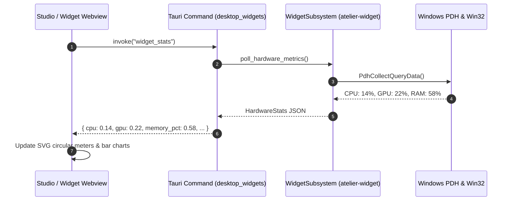

# atelier-widget

`atelier-widget` provides the system polling and native layered window infrastructure for **Atelier**'s desktop overlay widgets. It queries real-time Windows hardware performance metrics (CPU, RAM, GPU, VRAM, Battery), captures system media playback metadata via modern Windows Runtime APIs, and controls transparent desktop overlay windows.

```mermaid
flowchart TD
    subgraph Collectors ["Hardware & System Metric Collectors"]
        CPU["PDH / SystemTimes<br/>(CPU % Load)"]
        RAM["GlobalMemoryStatusEx<br/>(RAM Total, Free, Used)"]
        GPU["PDH / DXGI Query<br/>(GPU Engine Utilization & VRAM)"]
        Power["GetSystemPowerStatus<br/>(Battery %, AC Status)"]
        Media["Windows Media Session Manager<br/>(Track Title, Artist, Play/Pause)"]
        Clock["Local Clock & Calendar<br/>(Time, Date, Timezone)"]
    end

    subgraph Subsystem ["WidgetSubsystem (crates/widget)"]
        Aggregator["Aggregator & Poller<br/>(Thread-safe Cached State)"]
        Layered["layered.rs<br/>WS_EX_LAYERED Windows<br/>Click-through, Topmost, Frame bounds"]
    end

    subgraph Widgets ["Desktop Widgets Hosted in atelier-ui"]
        W1["Clock Widget"]
        W2["Calendar Widget"]
        W3["System Stats Widget"]
        W4["Media Controls Widget"]
        W5["Battery Status Widget"]
        W6["Sticky Notes Widget"]
        W7["Weather Forecast Widget"]
        W8["Photo / GIF Widget"]
        W9["Countdown Widget"]
        W10["Audio Visualizer Widget"]
    end

    CPU --> Aggregator
    RAM --> Aggregator
    GPU --> Aggregator
    Power --> Aggregator
    Media --> Aggregator
    Clock --> Aggregator

    Aggregator --> Subsystem
    Layered --> Widgets
```



---

## Architectural Highlights

### 1. Hardware Performance Metric Polling
- **CPU Load**: Collects accurate processor time across all cores using Windows Performance Data Helper (`PdhOpenQueryW`, `\Processor(_Total)\% Processor Time`) with automatic fallback to kernel `GetSystemTimes`.
- **GPU and VRAM**: Queries dedicated GPU engines and video memory budgets via DirectX Graphics Infrastructure (DXGI) and PDH performance counters (`\GPU Engine(*)\Utilization Percentage`).
- **Memory**: Samples virtual and physical RAM via `GlobalMemoryStatusEx`.
- **Battery**: Reads instantaneous battery percentages, charging states, and remaining operational time via `GetSystemPowerStatus`.



---

### 2. Media Transport Controls Integration
- Interfaces with the Windows `GlobalSystemMediaTransportControlsSessionManager` (SMTC) to display currently playing songs from Spotify, Apple Music, YouTube in web browsers, and media players.
- Exposes metadata (title, artist, album art) and dispatches media controls (Play, Pause, Skip, Previous).

---

### 3. Layered Window Infrastructure (`layered.rs`)
- Constructs Win32 layered overlay windows (`WS_EX_LAYERED`, `WS_EX_TOOLWINDOW`, `WS_EX_NOACTIVATE`).
- Supports seamless switching between **interactive edit mode** (movable, resizable, visible borders) and **ambient desktop mode** (`WS_EX_TRANSPARENT`, allowing clicks to pass through directly to desktop icons).
- Preserves layout margins across multi-monitor setups and different DPI scaling factors (100%, 125%, 150%, 200%).

---

## Widget Catalog

| Widget | Key Features | Update Frequency |
| :--- | :--- | :--- |
| **Clock** | Analog, digital, and typography styles; customizable 12h/24h formats; accent colors. | 1 second |
| **Calendar** | Monthly grid, current day highlight, week numbers, compact header. | 1 minute |
| **System** | Real-time CPU, GPU, RAM, and VRAM utilization dials; temperature and process counts. | 1 second |
| **Media** | Album artwork, track title, artist name, interactive play/pause and seek buttons. | On change / 500ms |
| **Battery** | Charge percentage, charging/plugged indicator, estimated runtime, low-power alerts. | 5 seconds |
| **Notes** | Markdown/plain-text sticky notes with customizable colors and persistent local storage. | On edit |
| **Weather** | Real-time weather and temperature powered by Open-Meteo (no API key required). | 15 minutes |
| **Photo** | Framed personal photos or animated GIFs with aspect ratio fit/cover options. | Static / Animation |
| **Countdown** | Target event countdown displaying remaining days, hours, and minutes with progress ring. | 1 minute |
| **Visualizer** | 64-band real-time audio spectrum reacting to system sound with bars, waves, dots, or circle. | 60 FPS (on sound) |

---

## Testing

```powershell
# Run unit tests for atelier-widget
cargo test -p atelier-widget
```
Unit tests validate widget bounding rectangles, coordinate normalization, DPI margin offsets, and GIF photo upload limits.
