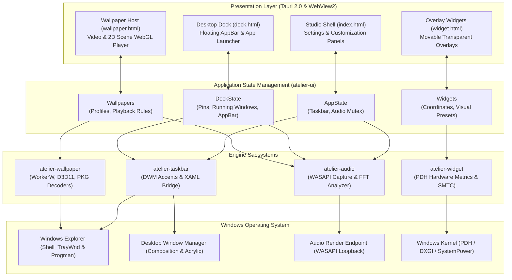
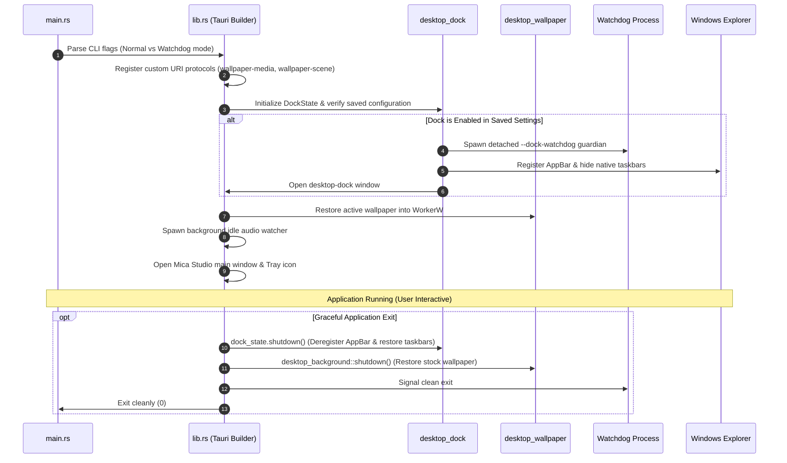

# System Architecture and Data Flow

Atelier is an advanced Windows-focused desktop personalization engine built on a high-performance modular Cargo workspace. The primary user-facing process is the `Atelier` Tauri 2.0 application (`atelier-ui`).

---

## Application Startup and Shutdown Flow

---

## Subsystem Interaction Paths

### 1. Taskbar Styling Path
1. UI actions dispatch Tauri commands (`set_taskbar_style`, `reset_desktop_dock`).
2. `TaskbarManager` resolves target `HWND` handles for `Shell_TrayWnd` across all connected displays.
3. Invokes `SetWindowCompositionAttribute` for DWM acrylic/blur and loads `atelier_xaml.dll` on Windows 11 to modify modern visual tree elements safely.
4. `recovery.rs` registers for `TaskbarCreated` to guarantee automatic recovery if Explorer restarts.

---

### 2. Live Wallpaper Path
1. The user selects a video or scene wallpaper in Studio.
2. `desktop_wallpaper.rs` invokes `acquire_workerw()` to locate the desktop background window layer beneath desktop icons.
3. Sets the wallpaper WebView window parent to `WorkerW` using `SetParent`.
4. The WebView loads assets via `wallpaper-media://` (HTTP range streaming) or `wallpaper-scene://` (on-the-fly PKG archive decompression).
5. `wallpaper_performance.rs` monitors fullscreen window events and battery power to pause rendering when appropriate.

---

### 3. Audio Reactivity Path
1. When the desktop visualizer, dock glow, or wallpaper pulse is active, the consumer calls `request_spectrum()`.
2. `atelier-audio` initializes a WASAPI loopback capture thread on the default audio endpoint.
3. Samples pass through a Hanning window and Radix-2 FFT, mapping 512 frequency samples into 64 musical logarithmic bands.
4. If all consumers are closed or silent for 3 consecutive seconds, the worker thread automatically suspends (0% CPU).
