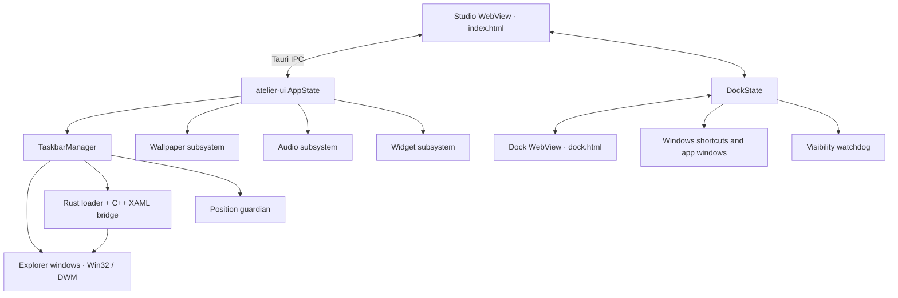

# Architecture & Data Flow

## Overview

Atelier is a Windows-focused Cargo workspace. The main user-facing process is the `Atelier` Tauri application in `atelier-ui`. Its embedded WebView communicates with Rust through Tauri commands and events. The application owns the taskbar manager, optional dock, wallpaper library and desktop widgets. The Audio tab configures a desktop visualizer that uses system output through the audio capture and analysis module.

## Startup and shutdown

1. `crates/ui/src/main.rs` handles helper-process and debug fixture arguments before starting the UI.
2. `crates/ui/src/lib.rs` constructs a default taskbar manager and starts its Explorer recovery listener. Saved taskbar styling is not automatically applied at startup.
3. The app attempts to initialize wallpaper and audio, creates the widget subsystem, opens the Tauri window and tray, and starts the dock from its saved settings.
4. Closing the main window or selecting Quit shuts down the dock, restores taskbar changes through the manager, and exits. The tray can also request a Windows reset.

The `atelier-core` binary is a separate experimental daemon with its own initialization and tray. It applies its own initial taskbar configuration and opens Studio HTML without Tauri IPC. Do not assume it is a separate service required by the Tauri application.

## Taskbar path

UI changes invoke commands in `atelier-ui`, which normalize configuration and call `TaskbarManager`. The manager discovers primary and secondary Explorer taskbar windows, applies composition and optional region geometry, and uses the XAML bridge for supported Windows 11 elements. The bridge is compiled from C++, embedded into the executable and extracted when needed. An Explorer-created listener attempts to reapply the current session's modifications. Restoration and OS-version constraints are described in [Recovery](FAILURES_AND_RECOVERY.md) and [Compatibility](COMPATIBILITY.md).

## Dock path

`DockState` owns persisted settings, cached icons and the list of taskbar windows it hid. `dock.html` and `dock.js` display the separate Tauri window; Studio uses `studio-dock.js` for controls. The backend enumerates shortcuts and windows, resolves icons and launches or activates applications. A watchdog must acknowledge readiness before each visible Explorer taskbar is hidden. A separate guardian handles the temporary taskbar auto-hide state, and an optional appbar reserves the configured maximized-window gap. Fullscreen detection controls dock visibility on its selected monitor. Turning off the dock restores the windows that Atelier recorded as visible. The native hidden-icons and input-language controls may not be accessible while Explorer's taskbar is hidden.

## Supporting subsystems

Studio provides a local wallpaper library, video and partial 2D scene playback, discovery and import of items downloaded by Steam, and desktop widget controls. The Tauri-side implementations are in `atelier-ui`; `atelier-wallpaper` supplies desktop hosting and format handling, and `atelier-widget` supplies widget data and window infrastructure. `atelier-audio` supplies shared WASAPI loopback capture and spectrum analysis for the desktop visualizer and optional wallpaper and dock effects. See the [crate references](STRUCTURE.md#crate-reference), [Wallpapers and Workshop](WALLPAPERS.md) and [Audio reactivity](AUDIO_REACTIVITY.md).
