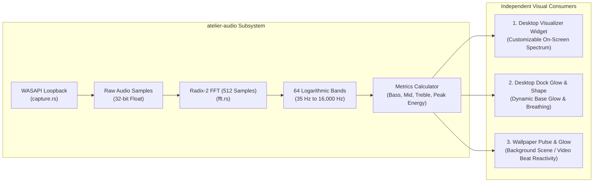
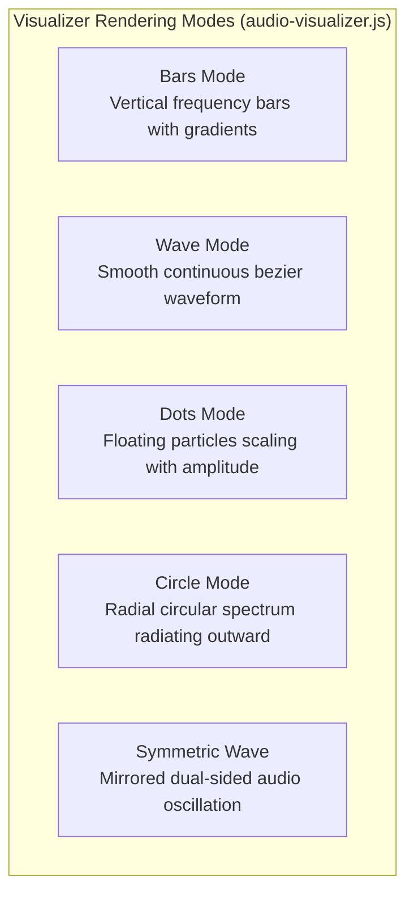
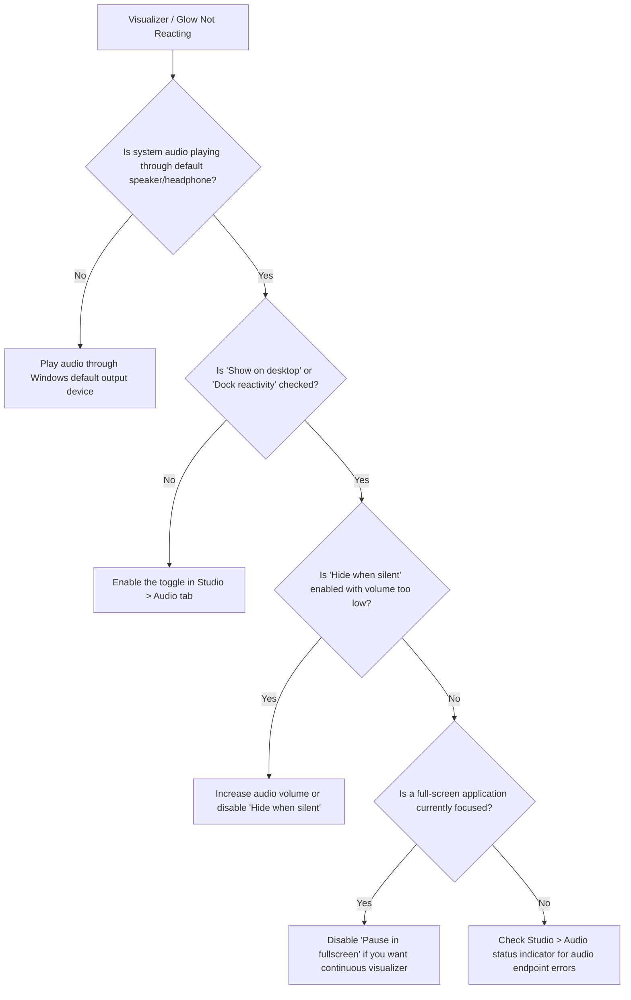

# Audio Reactivity

Atelier includes an advanced real-time audio reactivity subsystem powered by low-latency WASAPI loopback capture and a 64-band logarithmic FFT frequency analyzer. It can drive three independent visual consumers simultaneously.

---

## Consumer Breakdown

### 1. Desktop Audio Visualizer Widget
An ambient, transparent desktop widget that visualizes system audio at 60 FPS:

- **Customization Options**:
  - **Color & Gradients**: Single solid color or two-tone linear gradients with glow intensity.
  - **Bar Count & Thickness**: Adjustable from 16 to 64 bars with variable spacing.
  - **Smoothing & Decay**: Tunable attack (fast rise on beats) and decay (smooth falling tail).
  - **Silence Hiding**: Automatically fades out the visualizer when no audio is playing, leaving the desktop clean while continuing to listen in the background.

---

### 2. Dock Reactivity
Provides ambient illumination behind the floating macOS-style dock:
- **Audio Glow**: Emits an ethereal colored glow beneath the dock container proportional to system audio volume.
- **Dynamic Deformations**:
  - `Breathing`: Expands dock vertical padding rhythmically on heavy bass hits.
  - `Corners`: Pulses dock corner radius between sharp and pill shapes on transient attacks.
- **Frequency Filtering**: Select whether the dock reacts strictly to low bass frequencies (kicks, 808s), midrange frequencies (vocals, instruments), or overall energy.

---

### 3. Wallpaper Reactivity
Applies ambient visual reactions to any active video or 2D scene wallpaper:
- **Audio Pulse**: Slightly scales the wallpaper image from the screen center on bass drops (beat detection).
- **Audio Glow**: Blends a radial luminance bloom across the wallpaper when peak audio energy exceeds threshold.

---

## Technical Specifications

| Parameter | Specification |
| :--- | :--- |
| **Capture API** | Windows Audio Session API (WASAPI) in loopback mode |
| **Endpoint** | Default audio render endpoint (`eRender`, `eMultimedia`) |
| **FFT Frame Size** | 512 samples per transform |
| **Window Function** | Periodic Hanning window ($w(n) = 0.5 - 0.5 \cos(2\pi n / N)$) |
| **Frequency Range** | 35 Hz to 16,000 Hz mapped across 64 logarithmic bands |
| **Idle Timeout** | Automatically stops WASAPI capture thread after 3s of silence/inactivity (0% CPU) |

---

## Troubleshooting Guide

