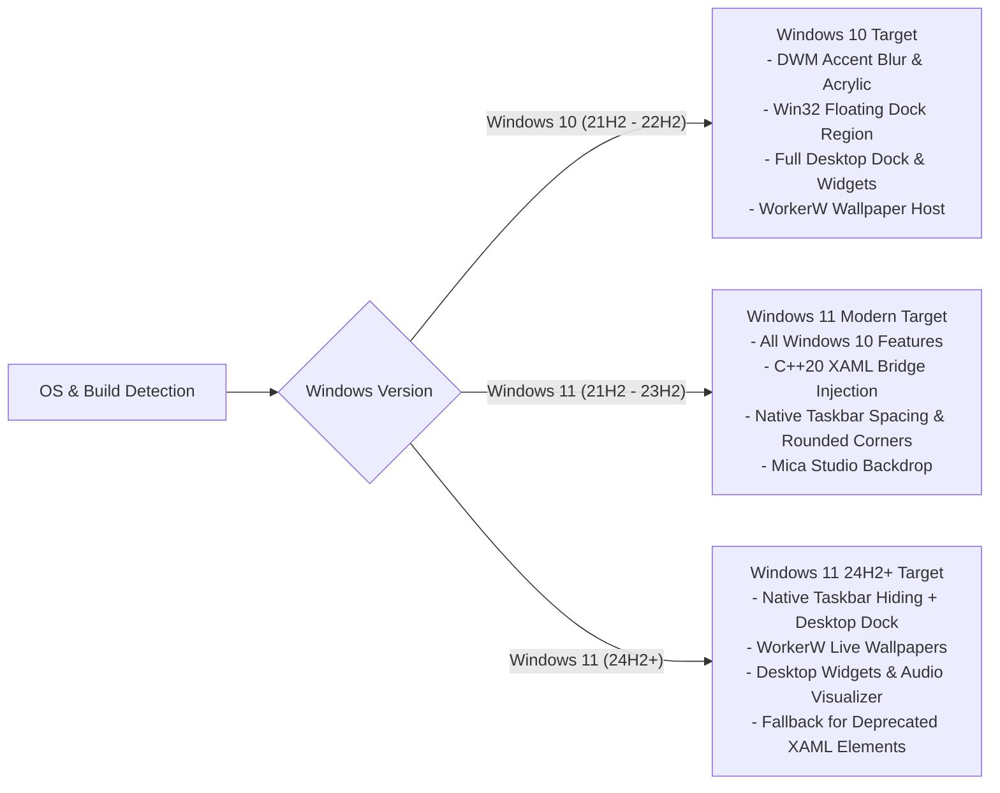

# Compatibility Matrix

Atelier targets modern 64-bit Windows installations. Because Atelier interacts with undocumented and evolving Windows shell internals, feature behavior varies between Windows 10 and different builds of Windows 11.

---

## Detailed Feature Matrix

| Feature | Windows 10 (19044+) | Windows 11 (22000+) | Windows 11 (22621+) | Windows 11 (26100+ / 24H2) |
| :--- | :---: | :---: | :---: | :---: |
| **Desktop Dock (macOS Style)** | Full Support | Full Support | Full Support | Full Support |
| **Live Wallpapers (Video & 2D)** | Full Support | Full Support | Full Support | Full Support |
| **Desktop Widgets Suite** | Full Support | Full Support | Full Support | Full Support |
| **Audio Spectrum Visualizer** | Full Support | Full Support | Full Support | Full Support |
| **Taskbar DWM Accent (Acrylic/Mica)**| Acrylic / Blur | Acrylic / Blur | Acrylic / Mica | Acrylic / Mica |
| **Native Floating Taskbar Region**| Full Support | Full Support | Partial (Centered) | Partial |
| **XAML Visual Tree Bridge** | N/A (Win32 Shell) | Supported | Supported | Partial (Shell changes) |
| **Studio Mica Backdrop** | Fallback (Acrylic) | Full Support | Full Support | Full Support |
| **AppBar Bottom Margin Reservation**| Full Support | Full Support | Full Support | Full Support |

---

## Hardware and Display Compatibility

- **Multi-Monitor Setups**: Supported with independent display DPI factors (e.g. 4K at 150% + 1080p at 100%).
- **GPU Acceleration**: Requires a Direct3D 11 compatible graphics adapter.
- **Web Runtime**: Requires the Microsoft Edge WebView2 Evergreen Runtime (pre-installed on Windows 11 and modern Windows 10).
