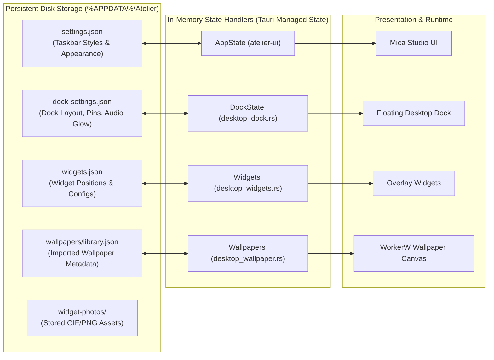

# Configuration and Storage Architecture

Atelier persists user preferences, widget coordinates, wallpaper libraries, and dock customizations in local, human-readable JSON files stored in the user's roaming application data directory.



---

## Storage Locations

By default, Atelier uses `%APPDATA%\Atelier`. You can override this path by setting the `ATELIER_DATA_DIR` environment variable prior to launching the application.

| File / Folder | Purpose | Format |
| :--- | :--- | :--- |
| `settings.json` | Native taskbar styling, accent policy, blur radius, and color presets. | JSON |
| `dock-settings.json` | Dock edge, icon size, magnification, pinned shortcuts, AppBar gap, and audio glow. | JSON |
| `widgets.json` | Grid coordinates, dimensions, enabled states, and visual presets for all desktop widgets. | JSON |
| `wallpapers/` | Contains `library.json`, imported video/scene directories, and extracted PKG assets. | Directory |
| `widget-photos/` | User-uploaded GIF and image assets displayed by the photo widget. | PNG / GIF |
| `cache/workshop-previews/`| Pre-composed composite thumbnails for downloaded Steam Workshop scenes. | Cached PNG |
| `atelier_xaml_<hash>.dll` | Extracted copy of the embedded C++20 XAML bridge DLL. | Native Binary |

---

## Schema Overview

### 1. `dock-settings.json`
```json
{
  "enabled": true,
  "edge": "Bottom",
  "alignment": "Center",
  "icon_size": 48,
  "magnification": 1.5,
  "spacing": 8,
  "padding": 10,
  "corner_radius": 18,
  "auto_hide": false,
  "hide_delay_ms": 300,
  "appbar_gap": 0,
  "launch_animation": true,
  "maximize_compatible": false,
  "audio_glow": {
    "enabled": true,
    "color": "#38bdf8",
    "strength": 0.8,
    "frequency": "bass",
    "shape": "breathing"
  },
  "pinned_apps": [
    { "name": "File Explorer", "path": "explorer.exe", "custom_icon": null }
  ]
}
```

---

## Environment Variables

| Variable | Type | Description |
| :--- | :--- | :--- |
| `ATELIER_DATA_DIR` | Path | Overrides the root configuration and wallpaper storage directory. |
| `ATELIER_DOCK_ONLY_TEST` | Boolean | Launches only the dock test fixture in isolated debug mode. |
| `ATELIER_DOCK_NATIVE_TEST` | Boolean | Runs the native Windows taskbar automated test fixture. |
| `NODE_PATH` | Path | Specifies custom Node module resolution paths for automated tests. |
| `ATELIER_TEST_BROWSER` | String | Overrides the browser channel for Playwright tests (`msedge`, `chrome`). |
