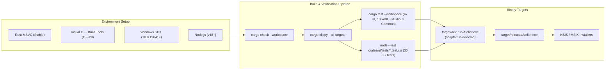

# Development and Testing Guide

This guide covers setup instructions, build configurations, and test procedures for developing and verifying **Atelier**.



---

## Prerequisites & Toolchain Setup

1. **Rust Toolchain**: Stable Rust with the `x86_64-pc-windows-msvc` target:
   ```powershell
   rustup default stable-x86_64-pc-windows-msvc
   ```
2. **C++20 Build Tools**: Visual Studio 2022 Build Tools with the "Desktop development with C++" workload installed (needed by `crates/taskbar/build.rs` to compile `native/xaml_bridge.cpp`).
3. **Windows SDK**: Version 10.0.19041.0 or higher.
4. **WebView2**: Microsoft Edge WebView2 Runtime.
5. **Node.js**: Required to execute the JavaScript test runner suites (`crates/ui/tests/`).

---

## Daily Development Workflow

Launch Atelier in development mode with live process management:
```powershell
# Terminates stale instances and runs target/dev-run/Atelier.exe
scripts\run-dev.cmd
```

---

## Verification Test Suites

### 1. Rust Workspace Unit Tests
```powershell
# Run all workspace unit tests across all 7 crates
cargo test --workspace

# Run specific crate tests
cargo test -p atelier-ui
cargo test -p atelier-wallpaper
cargo test -p atelier-audio
cargo test -p atelier-common
```

### 2. Frontend & Runtime JavaScript Tests
```powershell
# Run the 30 JavaScript unit tests using Node.js native test runner
node --test crates/ui/tests/*.test.cjs
```

### 3. Isolated Dock Test Fixtures
```powershell
# Run dock test fixture in safe sandbox without altering native taskbars
powershell -File scripts/test-desktop-dock.ps1
```

---

## Release Packaging

Atelier supports NSIS executable installers and MSIX packages:
- **NSIS**: `packaging/nsis/installer.nsi`
- **MSIX**: `packaging/msix/AppxManifest.xml`
