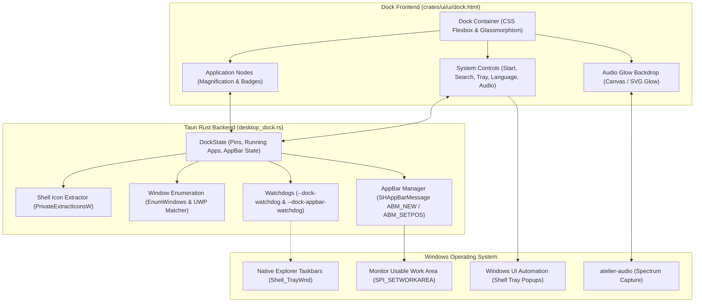
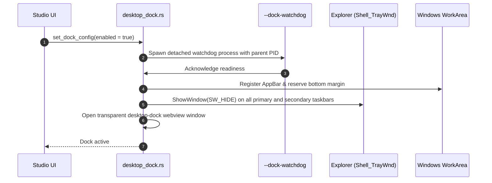
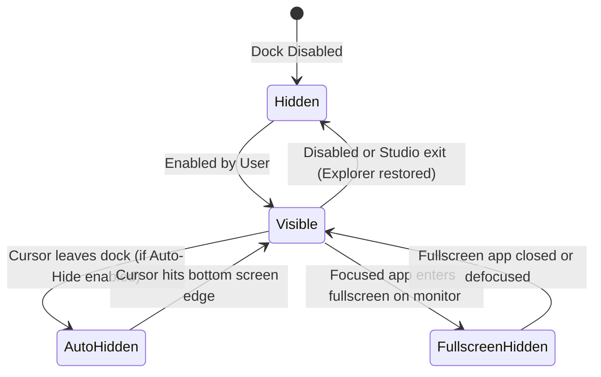

# Desktop Dock

The **macOS Taskbar** section in Studio's **Taskbar** tab controls Atelier's standalone floating desktop dock. Enabling it seamlessly replaces the native Windows taskbar with an interactive, animated dock.

---

## Architectural Highlights

### 1. Dock Activation & Taskbar Hiding Handshake
To prevent accidental desktop lockouts if the application crashes during startup, the dock executes a verified handshake before hiding Explorer taskbars:

If the parent process crashes or is terminated from Task Manager, `--dock-watchdog` detects process death via `WaitForSingleObject` and restores `Shell_TrayWnd` to `SW_SHOW` immediately.

---

### 2. Dock Window States & Visibility

- **Fullscreen Detection**: The dock tracks foreground window rects using `GetWindowRect` and `MonitorFromWindow`. When an active full-screen game or video is detected on the dock's display, the dock hides itself and suspends all audio reactivity to eliminate GPU and CPU overhead.

---

### 3. Application Matching & Icon Resolution
- **Win32 Applications**: Extracted directly using `PrivateExtractIconsW` at high resolutions (64x64 or 128x128 PNG).
- **UWP / Windows Store Apps**: Modern packaged apps run inside `ApplicationFrameHost.exe`. The dock resolves the underlying CoreWindow app user model ID (AUMID) to correctly display the app's real icon rather than generic host icons.
- **Steam Shortcuts**: Maps Steam game launchers (`steam://rungameid/<id>`) to the running game executable so running badges attach directly to pinned Steam games.

---

### 4. System Controls and Windows Tray Limitations

| System Button | Windows API / Shell Hook | Behavior |
| :--- | :--- | :--- |
| **Start** | `keybd_event(VK_LWIN)` | Opens the native Windows Start Menu. |
| **Search** | `keybd_event(VK_LWIN + 'S')` | Opens Windows Search overlay. |
| **Network & Volume**| Shell Notification invocation | Opens the Windows 11 Quick Settings flyout. |
| **Clock / Calendar** | `keybd_event(VK_LWIN + 'N')` | Opens the Notification Center and Monthly Calendar. |
| **Input Language** | UI Automation on Tray | Cycles or opens the Windows input language switcher. |
| **Hidden Icons** | UI Automation on SysTray | Expands the notification overflow chevron. |

> [!NOTE]
> Third-party notification area (system tray) icons remain hidden while the native taskbar is hidden. Atelier intentionally does not replicate third-party tray icons because Microsoft Windows does not expose a public API for foreign tray icon hosting.

---

### 5. Workarea Reservation (AppBar Gap)
When maximized windows are open, they normally expand across the entire monitor workarea. Atelier provides a **Space below maximized apps** slider:
- Registers a temporary system Application Desktop Toolbar (`SHAppBarMessage` with `ABM_NEW`).
- Updates `ABM_SETPOS` to set the exact bottom reservation height.
- Maximized applications respect this reserved boundary without overlapping the dock.
- Setting the slider to `0` deregisters the AppBar.
