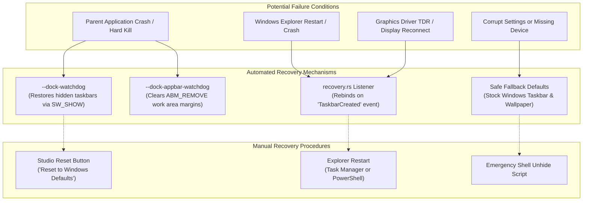
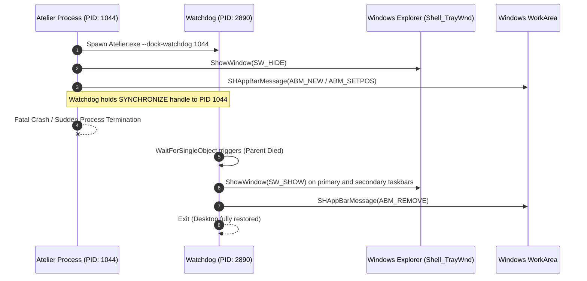

# Failure Modes and Recovery

Atelier operates directly with core Windows shell components, including Windows Explorer (`explorer.exe`), the Desktop Window Manager (DWM), and the `WorkerW` desktop layer. To safeguard system stability, Atelier implements multi-layered watchdog processes and automated failsafe mechanisms.



---

## Architectural Highlights

### 1. Watchdog Process Fault Tolerance
When Atelier hides the native Windows taskbars or reserves screen work area space, it immediately spawns independent detached supervisor processes:



---

## Specific Failure Scenarios & Solutions

### 1. The Windows Taskbar Remains Hidden
- **Root Cause**: The application was forcibly terminated before the normal cleanup routine could execute, and the watchdog was blocked.
- **Automated Fix**: Restarting Atelier and toggling the **macOS Taskbar** switch off will restore all recorded taskbars.
- **Manual PowerShell Fix**: Run the following in PowerShell:
  ```powershell
  # Emergency restore Windows taskbar visibility
  Add-Type -TypeDefinition '
    using System; using System.Runtime.InteropServices;
    public class Shell {
      [DllImport("user32.dll")] public static extern IntPtr FindWindow(string c, string t);
      [DllImport("user32.dll")] public static extern bool ShowWindow(IntPtr h, int c);
    }';
  $tb = [Shell]::FindWindow("Shell_TrayWnd", $null);
  [Shell]::ShowWindow($tb, 5);
  ```

---

### 2. Desktop Work Area or Maximized Windows Leave a Bottom Gap
- **Root Cause**: An AppBar reservation (`SHAppBarMessage`) was left active after an unexpected exit.
- **Automated Fix**: Running `Atelier.exe --dock-appbar-watchdog` or setting the **Space below maximized apps** slider to `0` in Studio releases the AppBar.
- **Manual Fix**: Restarting `explorer.exe` via Task Manager resets all system AppBars.

---

### 3. Explorer Restarts or Updates (Black Screen or Lost Taskbar Styling)
- **Root Cause**: Windows shell crashed or updated, creating new `HWND` handles for `Shell_TrayWnd` and `WorkerW`.
- **Automated Fix**: `recovery.rs` listens for the system-wide `TaskbarCreated` broadcast message. Upon receipt, Atelier automatically rediscovers the new taskbar handles and reapplies active styles without requiring a restart.

---

### 4. Live Wallpaper Plays Black Frame or Fails to Attach
- **Root Cause**: Graphic driver Timeout Detection and Recovery (TDR) occurred, or Explorer changed desktop window hierarchy order.
- **Automated Fix**: Atelier periodically inspects the z-order of `WorkerW`. If `SHELLDLL_DefView` drops behind the wallpaper host, Atelier automatically triggers `desktop_wallpaper::wallpaper_repair` to reinsert the wallpaper between the desktop icons and background.
