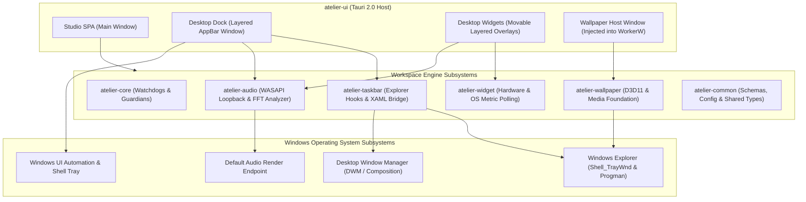
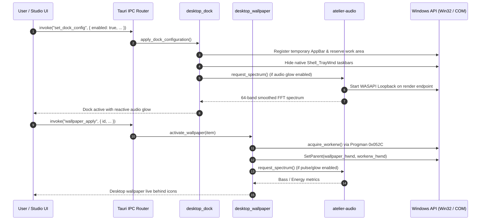

# Atelier Documentation Hub

Welcome to the technical documentation and developer guides for **Atelier**, an advanced desktop customization and enhancement suite for Microsoft Windows.

---

## Architecture and Subsystems Overview

Atelier is structured as a modular Cargo workspace targeting Windows 10 and 11. It leverages Tauri 2.0 and WebView2 for high-fidelity UI rendering while maintaining native performance through Rust Win32 APIs, Direct3D 11, and C++20 runtime hooks.

---

## Detailed Feature Guides

| Document | Primary Focus | Key Capabilities Covered |
| :--- | :--- | :--- |
| **[Desktop Dock](DOCK.md)** | macOS-style floating dock | Pinning shortcuts, running app detection, AppBar gap reservation, system tray popups, multi-monitor behavior. |
| **[Live Wallpapers](WALLPAPERS.md)** | Video and 2D scene wallpapers | MP4/WebM video looping, Wallpaper Engine 2D scene parsing, Steam Workshop discovery, multi-monitor rules. |
| **[Audio Reactivity](AUDIO_REACTIVITY.md)** | Real-time audio spectrum | WASAPI loopback, 64-band logarithmic FFT, visualizer widget, dock audio glow, wallpaper pulse. |
| **[Scene Playback](SCENE_PLAYBACK.md)** | 2D Wallpaper Engine parser | PKG unpacking, TEX/DXT decoding, layer hierarchies, bone animation, shader effects, author properties. |
| **[Configuration & State](CONFIGURATION.md)** | Storage and environment | `%APPDATA%\Atelier`, JSON schemas, portable data directories, registry and command-line flags. |
| **[Compatibility Matrix](COMPATIBILITY.md)** | Windows versions and caveats | Windows 10 (21H2+) & Windows 11 (22H2, 23H2, 24H2), UAC elevation, multi-monitor DPI scaling. |
| **[Failures & Recovery](FAILURES_AND_RECOVERY.md)** | Crash resilience & self-repair | Explorer watchdog, AppBar restoration, emergency key combos, taskbar unhide safeguards. |
| **[Security Architecture](SECURITY.md)** | Sandbox and permissions | Custom URI schemes (`wallpaper-scene://`, etc.), local-only IPC, path traversal barriers. |

---

## Workspace Crate Index

The engine is partitioned into specialized crates, each documented with its own standalone specification:

- **[`crates/ui`](../crates/ui/README.md) (`atelier-ui`)**: The primary Tauri 2.0 application executable. Manages the Studio UI, secondary windows (dock, widgets, wallpaper host), custom URI protocols, and IPC handlers.
- **[`crates/wallpaper`](../crates/wallpaper/README.md) (`atelier-wallpaper`)**: Low-level WorkerW desktop injection, Direct3D 11 rendering pipeline, Media Foundation video host, and Wallpaper Engine archive/texture decoders (`.pkg`, `.tex`).
- **[`crates/taskbar`](../crates/taskbar/README.md) (`atelier-taskbar`)**: Native Explorer taskbar manipulation, Acrylic/Mica compositions, floating dock regions, and C++20 XAML visual tree injection bridge.
- **[`crates/audio`](../crates/audio/README.md) (`atelier-audio`)**: Low-latency WASAPI loopback capture, Radix-2 FFT spectrum analysis with 64 logarithmic bands, and automatic on-demand idle management.
- **[`crates/widget`](../crates/widget/README.md) (`atelier-widget`)**: Desktop overlay widget subsystem providing hardware metrics (CPU, GPU, RAM, VRAM), clock, calendar, weather, media, notes, and countdowns.
- **[`crates/core`](../crates/core/README.md) (`atelier-core`)**: Background daemon and supervisor process orchestrating recovery watchdogs and native system tray hooks.
- **[`crates/common`](../crates/common/README.md) (`atelier-common`)**: Shared types, configuration models, color normalization utilities, and unified error definitions.

---

## Developer Workflows

For building, testing, and debugging Atelier:

- **[Development Guide](DEVELOPMENT.md)**: Toolchain requirements (Rust MSVC, C++20 build tools, Windows SDK, Node.js), debug profiles, test execution.
- **[Architecture Deep-Dive](ARCHITECTURE.md)**: Comprehensive architectural diagrams and component lifecycle models.
- **[Repository Structure](STRUCTURE.md)**: Directory layout, binary assets, and web resource management.
