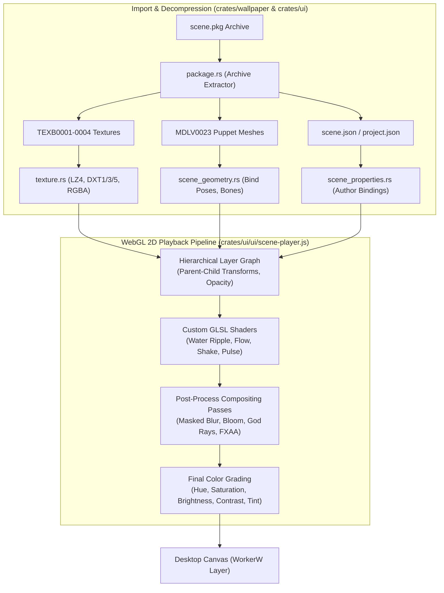
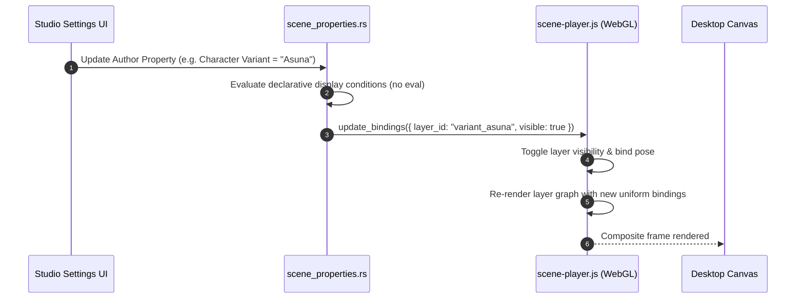

# Scene Playback Engine

Atelier provides a standalone hardware-accelerated 2D scene playback engine capable of importing and executing Wallpaper Engine `scene.pkg` projects without requiring Steam or Wallpaper Engine to be running.



---

## Architectural Highlights

### 1. Layer Hierarchy and Mesh Deformation
- **Hierarchical Transforms**: Propagates 2D transformation matrices (position, rotation, scale, visibility) from parent containers down to child layers.
- **Puppet Meshes (`MDLV0023`)**: Parses static 2D puppet mesh vertex coordinates, UV maps, and attachment bind poses without running heavy external skeletal runtime libraries.
- **Composite Passes**: Evaluates post-processing effects in strict author source order, rendering into ping-pong offscreen framebuffers.



---

## Feature Compatibility Matrix

| Category | Supported Features | Unsupported / Limitations |
| :--- | :--- | :--- |
| **Package & Container** | `PKGV0001`, `PKGV0002`, direct folder imports | Password-protected or encrypted packages |
| **Textures & Formats** | `TEXB0001`–`TEXB0004`, LZ4, DXT1, DXT3, DXT5, R8, RG88, PNG, JPEG | Animated texture atlases, animated GIFs |
| **Geometry & Meshes** | 2D image sprites, `MDLV0023` puppet meshes, attachment points, bind poses | 3D models (`.obj`, `.mdl3`), dynamic skeletal bone animation |
| **Shaders & Effects** | Water waves, ripples, flow maps, camera shake, pulse, masked blur, bloom, god rays, built-in rain | Arbitrary author custom HLSL/GLSL shaders, complex 3D particle systems |
| **Audio** | Looping MP3, OGG, WAV audio playback, volume and mute controls | Author SceneScript audio events |
| **Properties & Logic** | Boolean switches, sliders, color pickers, combos, declarative visibility conditions | Arbitrary JavaScript `SceneScript`, file selectors, external application shortcuts |

---

## Author Property Bindings & Security
- **No `eval` Execution**: Author visibility expressions are evaluated using a bounded arithmetic and logical AST parser (`scene_properties.rs`). Arbitrary JavaScript execution is impossible.
- **Deterministic State Swapping**: When importing or upgrading scenes, Atelier stages the entire target structure before swapping directories atomically, preventing corrupted or half-extracted assets from locking the renderer.

---

## Debugging and Diagnostic CLI Flags

```powershell
# Run headless GPU verification test bench
Atelier.exe --scene-engine-test path/to/scene.pkg output-dir/report.json

# Check static cover compositor output
Atelier.exe --scene-preview-test path/to/scene.pkg output.png

# Test author property controls and settings UI
Atelier.exe --scene-settings-test path/to/scene.pkg report.json
```
