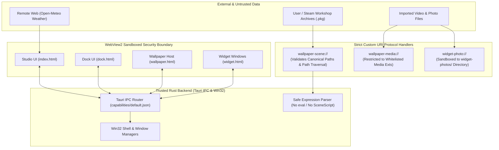

# Security Architecture and Considerations

Atelier operates with standard user permissions while interacting with native Windows shell components, Direct3D 11 hardware acceleration, and the local file system. This document outlines the security boundaries, sandboxing models, and data protection practices implemented across the project.

---

## Security Principles & Controls

### 1. File Access & Path Traversal Prevention
- All custom URI schemes (`wallpaper-scene://`, `wallpaper-media://`, `workshop-media://`, `widget-photo://`) sanitize incoming request URIs against directory traversal attacks (`../`, `%2e%2e`, backslash variations).
- Requests containing path traversal sequences or attempts to access root drive directories are rejected with `403 Forbidden` before opening file handles.

---

### 2. Prevention of Arbitrary Code Execution
- **No `eval` Execution**: Wallpaper Engine scenes often contain dynamic conditions to toggle layer variants (e.g. alternate clothing or hair). Atelier parses these conditions using a bounded arithmetic and boolean expression AST evaluator (`crates/ui/src/scene_properties.rs`). Arbitrary JavaScript execution is impossible.
- **SceneScript and Custom Shaders Blocked**: Arbitrary foreign binary shaders and JavaScript SceneScripts embedded inside third-party packages are discarded at import time and never evaluated.

---

### 3. Audio Capture & Privacy Protection
- **Output Loopback Only**: The `atelier-audio` crate explicitly configures WASAPI for render loopback (`eRender, eMultimedia`). It does **not** initialize capture endpoints (`eCapture`) and cannot record the user's microphone.
- **Zero Audio Storage**: Audio samples are processed strictly in a 512-sample circular buffer in volatile RAM and immediately discarded after computing the FFT spectrum. No audio recordings are ever written to disk or transmitted over the network.

---

### 4. Least Privilege & UAC Elevation
- Atelier does not require Administrator privileges to run. All taskbar composition styling, dock AppBar reservations, and wallpaper injections execute under standard user security tokens.
