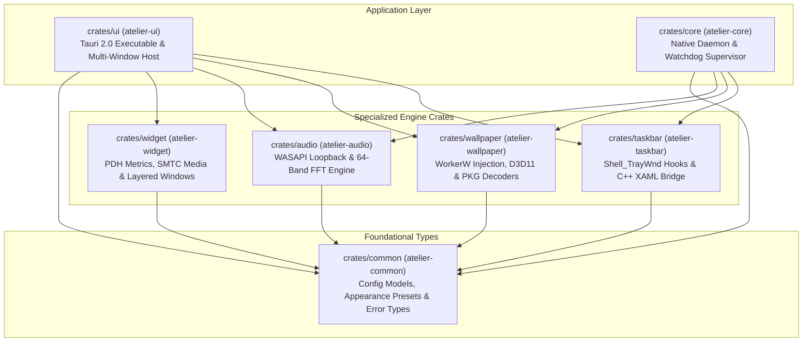

# Repository Structure and Crate Graph

Atelier is structured as a multi-crate Cargo workspace separating frontend UI presentation, hardware capture, and low-level Win32 shell hooks.



---

## Directory Layout

```text
atelier/
├── Cargo.toml                  # Workspace definition and dependency matrix
├── crates/
│   ├── common/                 # atelier-common: Shared types, error enum, presets
│   ├── core/                   # atelier-core: Daemon binary, CLI args, watchdogs
│   ├── taskbar/                # atelier-taskbar: Explorer hooks, AccentPolicy, XAML
│   │   └── native/             # C++20 XAML bridge (xaml_bridge.cpp, xaml_probe.cpp)
│   ├── ui/                     # atelier-ui: Main Tauri 2.0 interactive application
│   │   ├── capabilities/       # Tauri 2.0 window capabilities & security permissions
│   │   ├── src/                # Rust backend modules (dock, wallpaper, widgets)
│   │   ├── tests/              # Node.js automated test suites (*.test.cjs)
│   │   └── ui/                 # Frontend web assets (HTML, CSS, JS, scene engine)
│   ├── wallpaper/              # atelier-wallpaper: WorkerW, D3D11, PKG/TEX decoders
│   ├── audio/                  # atelier-audio: WASAPI loopback, Radix-2 FFT
│   └── widget/                 # atelier-widget: Hardware metrics & layered windows
├── docs/                       # Comprehensive documentation portal & guides
│   └── crates/                 # In-depth technical documentation for each crate
├── packaging/                  # Release installers (NSIS installer.nsi, MSIX Appx)
└── scripts/                    # Developer scripts (run-dev.cmd, dock tests)
```

---

## Crate Directory & Package Reference

| Directory | Cargo Package | Technical Reference | Key Responsibilities |
| :--- | :--- | :--- | :--- |
| `crates/common` | `atelier-common` | [Common Reference](crates/COMMON.md) | Config models, presets, unified `AtelierError` |
| `crates/core` | `atelier-core` | [Core Reference](crates/CORE.md) | Detached watchdogs, system mutex, tray icon |
| `crates/taskbar` | `atelier-taskbar` | [Taskbar Reference](crates/TASKBAR.md) | Explorer injection, DWM accents, C++20 XAML bridge |
| `crates/ui` | `atelier-ui` | [UI Reference](crates/UI.md) | Studio SPA, dock window, widgets, custom protocols |
| `crates/wallpaper` | `atelier-wallpaper` | [Wallpaper Reference](crates/WALLPAPER.md) | WorkerW acquisition, D3D11, PKG/TEX decompressors |
| `crates/audio` | `atelier-audio` | [Audio Reference](crates/AUDIO.md) | WASAPI loopback capture, 64-band logarithmic FFT |
| `crates/widget` | `atelier-widget` | [Widget Reference](crates/WIDGET.md) | PDH hardware metrics, SMTC media, layered windows |
