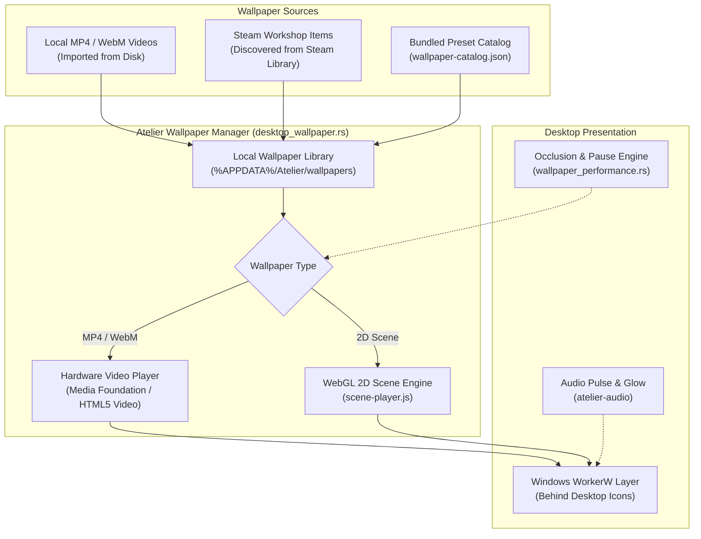
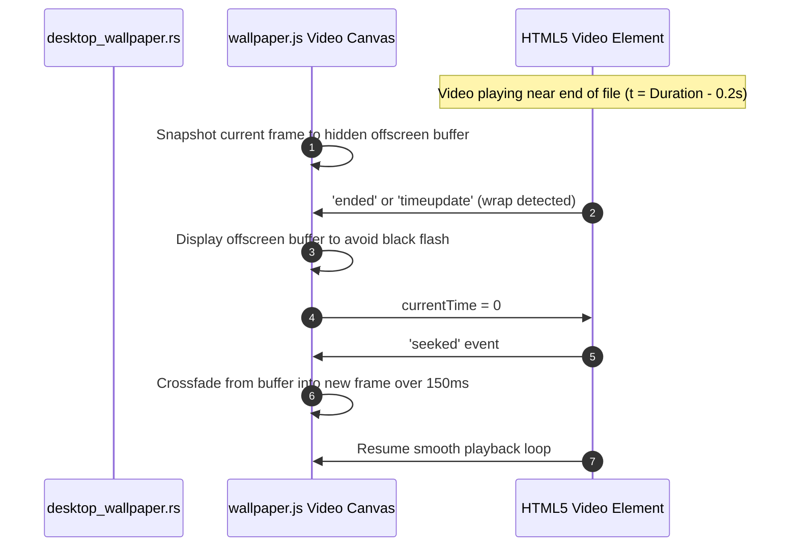
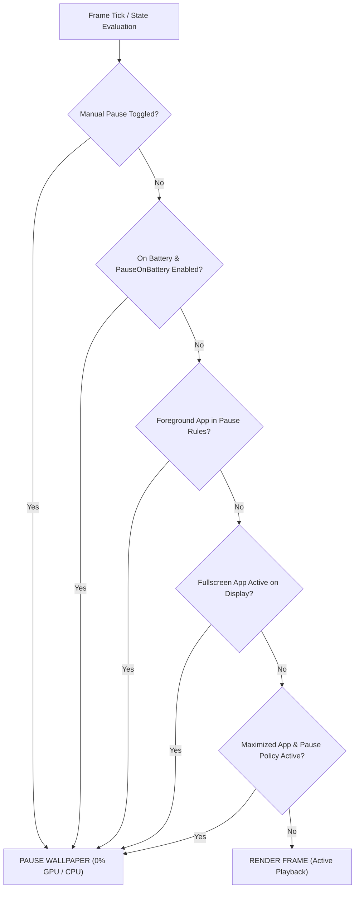

# Wallpapers and Steam Workshop

Atelier includes a hardware-accelerated desktop wallpaper engine capable of playing looped MP4 and WebM videos as well as interactive 2D Wallpaper Engine scenes directly behind desktop icons.

---

## Architectural Highlights

### 1. Seamless Video Looping with Frame Crossfading
Standard HTML5 video elements often produce noticeable micro-stutters or black flashes when seeking back to timestamp zero at the end of a loop. Atelier resolves this through a frame-holding crossfading strategy:

---

### 2. Steam Workshop Discovery & Safe Importing
Atelier can discover wallpapers you have already subscribed to and downloaded in Steam without requiring Steam to remain open or running Depot downloaders:
1. **Steam Path Discovery**: Scans Windows registry keys (`HKCU\Software\Valve\Steam`) and `libraryfolders.vdf` to discover all Steam library drives.
2. **Workshop Directory**: Scans `steamapps/workshop/content/431960/` for Wallpaper Engine items.
3. **Item Parsing**: Reads `project.json` to extract titles, previews (`preview.jpg`), type tags (`scene`, `video`, `web`), and author information.
4. **Isolated Copying**: Importing copies the video or extracts the `.pkg` into Atelier's local library (`%APPDATA%\Atelier\wallpapers\`). The wallpaper continues to work even if Steam is completely closed or offline.

---

### 3. Comprehensive Performance & Pause Decision Pipeline

### Policy Hierarchy & Override Rules
1. **Application Rules**: Explicit per-executable rules (`chrome.exe: pause`, `game.exe: pause`) always take highest priority.
2. **Global Policies**: Configured in **Wallpapers > Settings** for battery saver, fullscreen apps, and other audio playback.
3. **Per-Wallpaper Preferences**: Individual wallpaper settings (volume, fit, scaling, fullscreen toggle) inherit global defaults unless explicitly overridden.

---

## Supported Wallpaper Types

| Type | Extension / Format | Engine | Audio Reactive? |
| :--- | :--- | :--- | :--- |
| **Video** | `.mp4`, `.webm` | Hardware Video Decoder | Yes (Pulse & Glow) |
| **2D Scene** | `scene.pkg`, `scene.json` | WebGL 2D Scene Player | Yes (Pulse, Glow & Engine scripts) |
| **Web** | `index.html` | Chromium Sandbox | Under Development |
| **3D Scene** | `.pkg` (3D Models) | WebGL 3D Engine | Experimental (Partial) |
