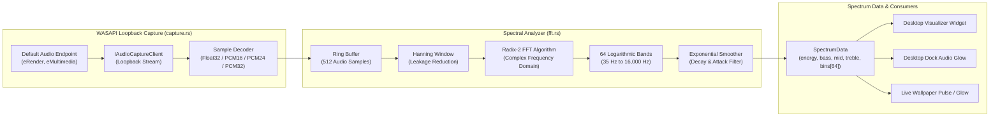
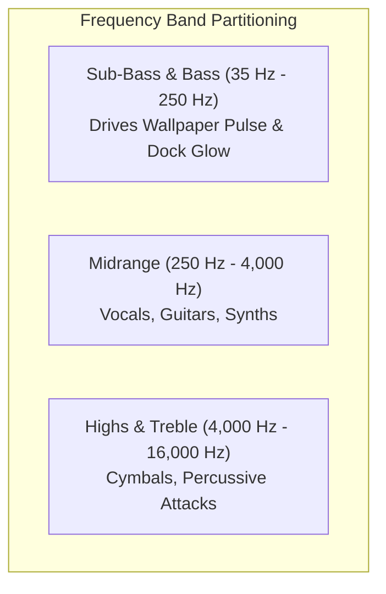
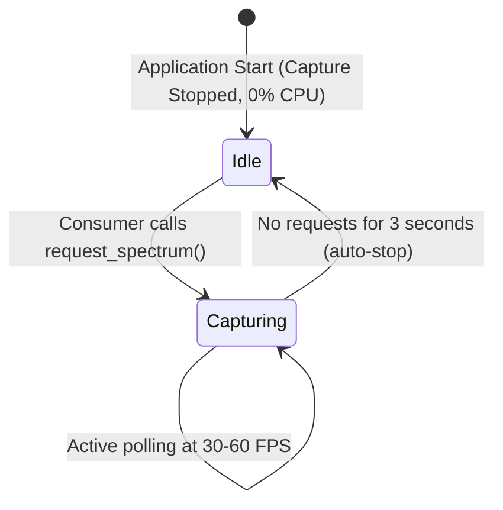

# atelier-audio

Directory: [`crates/audio`](../../crates/audio/) · Cargo package: `atelier-audio`

`atelier-audio` is the real-time audio capture, spectral analysis, and reactivity engine for **Atelier**. It provides low-latency WASAPI loopback recording, Cooley-Tukey Radix-2 FFT computation with 64 logarithmic frequency bins, and zero-overhead idle power management.



---

## Architectural Highlights

### 1. Robust WASAPI Loopback Capture
- Captures system audio directly from the default playback device without requiring virtual audio cables, stereo mix drivers, or microphone permissions.
- Automatically handles diverse endpoint formats (32-bit float, 16-bit integer, 24-bit packed integer, 32-bit integer).
- Sanitizes non-finite samples (`NaN`, `±Infinity`) to prevent numeric corruption in downstream filters.
- **Dynamic Device Switching**: Continuously monitors Windows audio endpoint GUIDs. If the user plugs in headphones or changes the default output device, the capture loop gracefully cleans up COM resources and rebinds to the new device without requiring an application restart.

---

### 2. Logarithmic FFT Frequency Binning
Human hearing perceives pitch logarithmically. Linear FFT bins over-represent high frequencies and under-represent bass. `atelier-audio` maps 512 discrete frequency bins into 64 musical bands using exponential scaling:

$$\text{Frequency}(b) = 35 \times \left(\frac{\min(f_s/2, 16000)}{35}\right)^{\frac{b}{64}}$$



Peak energy tracking within each frequency partition prevents individual quiet frequencies from being washed out by loud adjacent frequencies.

---

### 3. On-Demand Capture & Zero-Overhead Idle Management
To avoid draining CPU cycles and laptop batteries when visualizers and audio-reactive effects are hidden:
- The capture thread is **not** kept running permanently.
- Calling `request_spectrum()` automatically spins up the WASAPI capture thread if it was stopped.
- A background supervisor executes `stop_if_idle(Duration::from_secs(3))`. If no widget or wallpaper requests spectrum data for 3 consecutive seconds, the worker thread uninitializes COM and suspends execution completely (0% CPU).



---

## Crate Modules

| Module | Source File | Description |
| :--- | :--- | :--- |
| **WASAPI Capture** | [`src/capture.rs`](../../crates/audio/src/capture.rs) | WASAPI loopback thread, sample format decoders, silence detection, and endpoint change watchdog. |
| **Spectral Analysis** | [`src/fft.rs`](../../crates/audio/src/fft.rs) | In-place Radix-2 Cooley-Tukey FFT, Hanning window generator, 64 logarithmic bins, and exponential smoothing. |
| **Visualizer State** | [`src/visualizer.rs`](../../crates/audio/src/visualizer.rs) | Dynamic color tint derivation, energy beat detection, and pulse state management. |
| **Manager Facade** | [`src/lib.rs`](../../crates/audio/src/lib.rs) | `AudioManager` struct, lazy initialization, thread-safe spectrum access, and idle timeouts. |

---

## Testing

```powershell
# Run unit tests for atelier-audio (3 tests)
cargo test -p atelier-audio
```
Unit tests verify that pure tones separate into correct bass/treble bins and stay bounded, silence produces zero energy, and sample decoders discard non-finite inputs.
