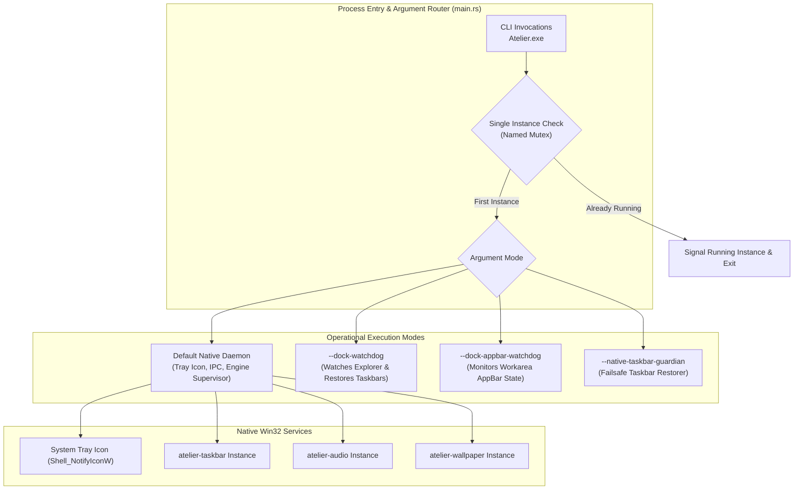
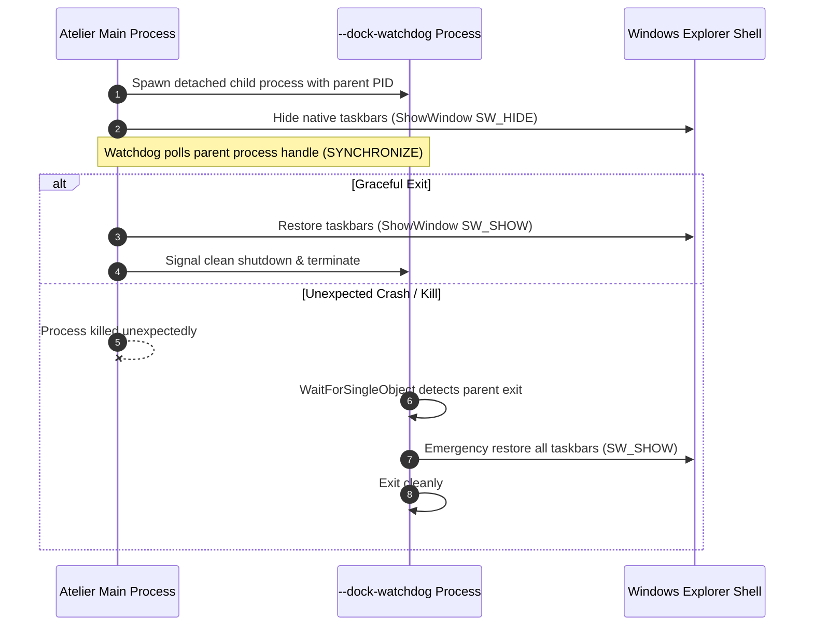

# atelier-core

Directory: [`crates/core`](../../crates/core/) · Cargo package: `atelier-core`

`atelier-core` contains the native background daemon, standalone CLI runner, system tray integration, and detached watchdog processes that safeguard Windows shell stability.



---

## Architectural Highlights

### 1. Guardian and Watchdog Processes
To guarantee that the user's desktop never remains in an unusable state if an unexpected crash occurs, `atelier-core` can launch itself as a lightweight detached watchdog:
- **`--dock-watchdog`**: Monitors the parent application process ID. If the parent process terminates without gracefully unhiding the Windows taskbar, the watchdog immediately unhides all `Shell_TrayWnd` and `Shell_SecondaryTrayWnd` windows.
- **`--dock-appbar-watchdog`**: Ensures that temporary desktop workarea reservations registered with the `SHAppBarMessage` API are cleanly deregistered (`ABM_REMOVE`), preventing persistent screen margins when the application closes.
- **`--native-taskbar-guardian`**: Monitors the health of Explorer's native taskbar and reapplies default taskbar window styles if custom styling hooks fail.



---

### 2. Native System Tray Notification
- Creates a dedicated hidden message window to receive `WM_USER` taskbar notifications.
- Adds an icon to the Windows notification area via `Shell_NotifyIconW`.
- Provides context menu shortcuts for opening Studio, pausing wallpapers, resetting appearance to Windows defaults, or safely quitting the application.

---

## Testing & CLI Usage

```powershell
# Launch daemon in standalone mode
cargo run -p atelier-core

# Run watchdog test harness
cargo run -p atelier-core -- --dock-watchdog 1234
```
