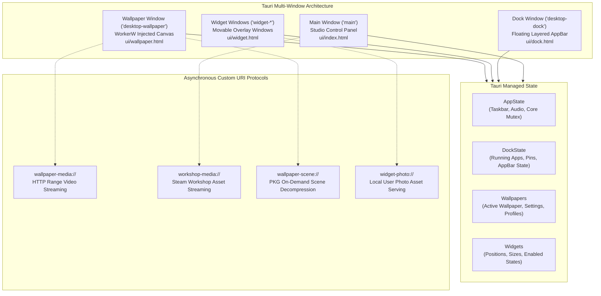
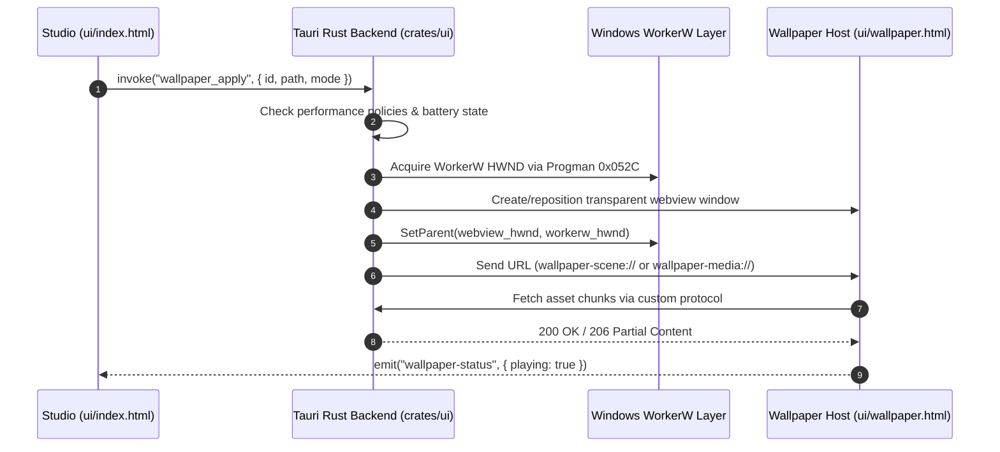

# atelier-ui

Directory: [`crates/ui`](../../crates/ui/) · Cargo package: `atelier-ui`

`atelier-ui` is the primary interactive user-facing application for **Atelier**, built on the **Tauri 2.0** framework and Microsoft WebView2. It hosts the Studio control panel, the floating desktop dock, customizable desktop overlay widgets, and the background live wallpaper runtime window.



---

## Architectural Highlights

### 1. Multi-Window Lifecycle & Window Management
- **Mica Studio Shell**: The main configuration window utilizes Windows 11 Mica backdrop composition with dark mode styling, providing access to Taskbar, Dock, Wallpapers, Widgets, Audio, and General settings.
- **Desktop Dock Window**: Operates as a transparent, layered, frameless window anchored to display edges (bottom, top, left, right). It communicates directly with Windows shell services using custom AppBars to reserve work areas.
- **Desktop Widgets**: Each enabled desktop widget runs in its own lightweight WebView window with transparent background, click-through toggles, and DPI-aware positioning.
- **Desktop Wallpaper Window**: Injected directly behind the desktop icons into the Windows `WorkerW` layer (between `SHELLDLL_DefView` and the desktop background).



---

## Key Backend Modules

| Module | Source File | Description |
| :--- | :--- | :--- |
| **Desktop Dock** | [`src/desktop_dock.rs`](../../crates/ui/src/desktop_dock.rs) | Taskbar enumeration, Explorer icon extraction, UWP ApplicationFrameWindow matching, pinned shortcut persistence, Windows AppBar space reservation, and UI Automation system tray popups. |
| **Desktop Wallpaper** | [`src/desktop_wallpaper.rs`](../../crates/ui/src/desktop_wallpaper.rs) | Live wallpaper lifecycle controller, profile persistence, audio reactivity options, and `wallpaper-media://` byte-range video streaming. |
| **Scene Engine Bridge** | [`src/wallpaper_scene.rs`](../../crates/ui/src/wallpaper_scene.rs) | Extraction of Wallpaper Engine `.pkg` archives, JSON project parsing, and `wallpaper-scene://` protocol asset server. |
| **Scene Geometry** | [`src/scene_geometry.rs`](../../crates/ui/src/scene_geometry.rs) | Scene layer transformations, parent-child hierarchies, 2D bone rigs, and mesh deformation resolution. |
| **Scene Effects** | [`src/scene_effects.rs`](../../crates/ui/src/scene_effects.rs) | Shader effect passes, uniform binding evaluation, author composite switches, and arithmetic expressions. |
| **Scene Preview** | [`src/scene_preview.rs`](../../crates/ui/src/scene_preview.rs) | Offscreen CPU/GPU thumbnail composition engine generating full-fidelity PNG previews of 2D scenes. |
| **Performance Watcher**| [`src/wallpaper_performance.rs`](../../crates/ui/src/wallpaper_performance.rs) | Real-time monitoring of fullscreen/maximized applications, battery status, process execution pause rules, and display frame rate caps. |
| **Steam Workshop** | [`src/steam_workshop.rs`](../../crates/ui/src/steam_workshop.rs) | Automatic detection of Steam install folders and Wallpaper Engine Workshop downloads (`workshop/content/431960`), VDF parsing, and safe importing. |
| **Desktop Widgets** | [`src/desktop_widgets.rs`](../../crates/ui/src/desktop_widgets.rs) | Widget position normalization, multi-monitor bounds validation, drag-and-drop coordinate persistence, and audio spectrum dispatch. |
| **Desktop Background** | [`src/desktop_background.rs`](../../crates/ui/src/desktop_background.rs) | Safe backup and atomic restoration of the native Windows wallpaper when live wallpapers are toggled or on application exit. |

---

## Custom Protocol Handlers

`atelier-ui` registers four asynchronous URI scheme protocols to safely stream local assets to WebViews without triggering Chromium cross-origin or file-access security errors:

1. **`wallpaper-media://`**: Supports HTTP `Range: bytes=start-end` requests, allowing seamless hardware-accelerated video streaming and loop seeking for large MP4 and WebM videos.
2. **`wallpaper-scene://`**: Resolves local scene directories and `.pkg` archive contents on the fly, streaming unpacked images, models, and JSON definitions directly into the WebGL player.
3. **`workshop-media://`**: Provides sandboxed access to preview images and media files stored in Steam Workshop directories.
4. **`widget-photo://`**: Serves local GIF and image uploads for the desktop photo widget.

---

## Testing

```powershell
# Run Rust unit tests for atelier-ui (47 tests)
cargo test -p atelier-ui

# Run JavaScript frontend unit tests (30 tests)
node --test crates/ui/tests/*.test.cjs
```
